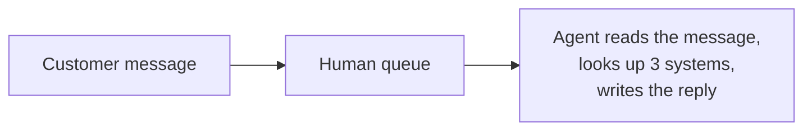
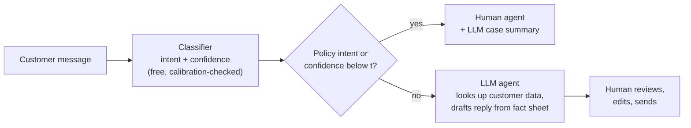
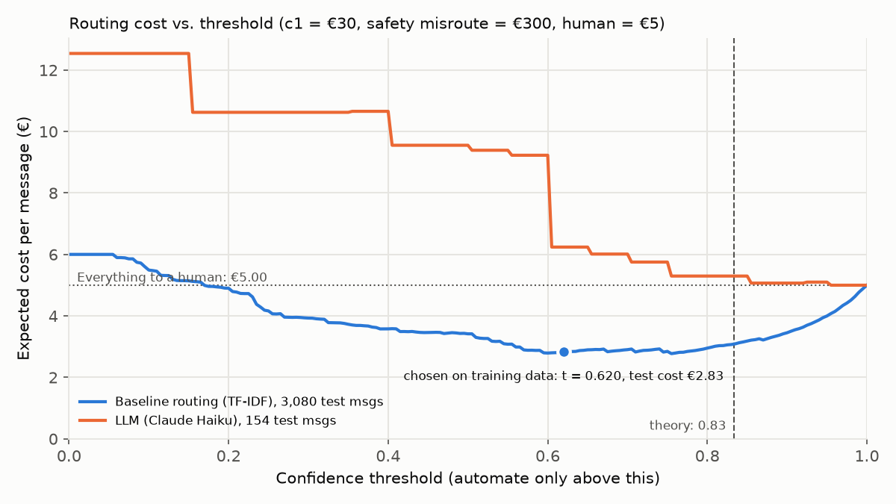

# Bank customer-service assistant: when should the AI hand over to a human?

A working prototype of an AI assistant for a bank's customer service. It reads a customer's message,
works out what they want, looks up their data in (simulated) bank systems, and then **answers**, **asks one
clarifying question**, or **hands the case to a human** with a ready-made summary.

The core of the project is an operations-research question: **when should the AI hand over to a human?**
It is treated as cost minimisation. A wrong automated answer costs the bank more than a human handling the
case, so the confidence threshold for automating a message is chosen to minimise expected cost, and then the
whole design is measured end to end.

> Built as a portfolio project for CGI Finland's *AI Trainee – Business & Solution Design* (Financial
> Services). The posting's scenario: *a customer's message may be incomplete and resolving it may need several
> systems; the AI should make sense of the situation, move it forward, recognise its own limits and bring in a
> human at the right moment.*

## The result in one paragraph

**Routing is solved; reply quality is the open question.** A cheap classifier (TF-IDF + logistic regression)
decides reliably *who* should handle a message. On routing alone it could save at most about **€2.2–2.6 per
message** against sending everything to a human, with a safety trade-off that can be tuned and read off a
curve. But when the full design was measured (the classifier routes, the LLM writes the reply, a second model
grades it), the LLM fully and correctly handled only **about 1 message in 5**, and its answers on their own cost
more than a human. With consistent pricing the measured system costs **€5.1–6.0 per message against €5.00 for
human-only**: it has **not been shown to beat** human-only handling. The estimate is rough and probably
pessimistic, because of artefacts of the simulation. Recommendation on this evidence: **use the classifier
for triage and the LLM to draft replies and case summaries for human agents, not to auto-send.**

| Strategy (154–3,080 test messages) | Cost per message | Notes |
|---|---|---|
| Everything to a human | **€5.00** | the baseline to beat |
| Classifier routing only, threshold 0.62 | €2.83 | *upper bound*: assumes every routed message gets a correct reply; 61% automated; 5 of 440 fraud/dispute/AML messages slip through |
| Classifier routing only, threshold 0.9 | €3.45 | 32% automated; 0 of 440 slip through (95% upper bound 0.7%) |
| **Measured hybrid** (routing + LLM replies, graded) | **€5.1–6.0** | range over judge readings and clarify prices; 95% intervals include €5.00 in all but the strictest reading |
| Review queue with the measured LLM drafts | €4.66–5.25 | a human approves every draft; review priced at €1–2 |

Assumed costs: **€30** for a wrong automated answer, **€300** for automating a message that must go to a human
(a placeholder), **€5** for human handling. Sensitivity analyses for all of them are in the report.

📄 **One-page business brief: [`report/brief.pdf`](report/brief.pdf)**, written for a bank's decision-makers
(no technical background needed).

📄 **Full explanation: [`report/report.pdf`](report/report.pdf)** (37 pages, every concept explained from
scratch, including a revision log of what an internal review found wrong in the first version).

## The problem

A bank receives a steady stream of messages such as *"my card still hasn't arrived"*, *"why was I charged
twice?"* or *"help my money isnt showing up"*. Humans answer them reliably but expensively. An AI can answer
instantly, but a confident wrong answer to a bank customer causes real damage. Some cases (suspected fraud,
money disputes, anti-money-laundering checks) should never be decided by an AI at all.

## Solution design

**Before:** every message waits in a human queue, and the agent starts from nothing.



**After (recommended on the current evidence):** the classifier triages; the LLM prepares the work.



Key design choices:

- **Two separate reasons to hand off.** *By rule, because of risk:* 11 of the 77 intents (fraud, disputes,
  account closure, source of funds, identity failures) always go to a human, whatever the AI thinks
  ([`src/policy.py`](src/policy.py)). *By threshold, because of uncertainty:* for everything else, the AI acts
  only when the classifier's confidence is above a cost-optimal threshold.
- **The LLM suggests, the code decides.** Business rules are enforced in ordinary, testable code, not by hoping
  the model obeys the prompt. In the LLM-only run, the rule overrode the model 5 times.
- **Least privilege.** The LLM's tools take no customer ID; the code fills in the logged-in customer, so a
  message cannot make the model look at anyone else's data.
- **Data minimisation (GDPR).** The model only sees the profile fields it needs. Removing the profile's
  language field also fixed a bug where English messages got Finnish replies.
- **Grounding.** The LLM may only state fees, limits, times and app steps that appear in the bank's fact sheet
  ([`data/bank_facts.md`](data/bank_facts.md)) or the customer's data. This removed invented numbers, but not
  all invented facts (see below).
- **Fail safe.** If anything goes wrong (the model refuses, runs out of space or loops), the case goes to a
  human.

## Results

### 1. The classifier beats the LLM at picking the intent, on this benchmark's terms

| | Intent accuracy (same 154 messages) | Cost per message |
|---|---|---|
| TF-IDF + logistic regression | **87.7%** (89.4% on all 3,080 test messages) | ≈ $0 |
| Claude Haiku 4.5, zero-shot | 70.1% | $0.0084 |

The comparison is biased against the LLM: it saw only the 77 label names, while the classifier learned from
10,003 labelled examples, and some "errors" are BANKING77 labelling conventions. The claim is narrow:
*zero-shot* Haiku loses to a supervised classifier *on this dataset*.

### 2. The optimal threshold is a property of the model, not a formula

Decision theory says: automate when the probability of being right exceeds 1 − c2/c1 = 0.83. The optimal
threshold on data was **0.62**, because the classifier is **underconfident** (messages it scores around 0.55
are already right more than 80% of the time). With a weaker regularisation setting (C = 100) the same model becomes well
calibrated and its optimal threshold moves to 0.875, close to the theory. So **the threshold must be chosen on
held-out data for the model actually deployed**, and the rule has to be applied to *real* accuracy, not raw
scores.



### 3. Safety is a curve, not a number

How many of the 440 test messages that must go to a human would be automated, for each threshold:


At 0.62, 5 of 440 (1.1%) slip through, which is not acceptable for auto-send. At 0.9 none were observed
(95% upper bound 0.7%), but only 32% of messages are automated.

### 4. Measured end to end, reply quality decides

Given the **correct** intent (98% of the time), Haiku wrote a reply that a stronger model (Claude Sonnet 5)
then graded:

- only **29 of 154 messages (19%)** were fully and correctly handled by the AI;
- the judge flagged **9 of 38** answers as wrong (24%, 95% interval 13–39%). I read all 9 and agree with 7,
  none of which the automatic number or menu-path checks caught (e.g. top-up limits applied to disposable
  cards, an invented card-renewal policy);
- on its own, **the answering path costs €5.5–7.1 per attempt, more than a human's €5**;
- the LLM asked a clarifying question in 37 of 91 cases. Priced consistently (a question is followed by a
  second turn), the hybrid costs **€5.1–6.0 per message**.

## How the conclusion changed

The first version of this project reported that the optimal threshold "roughly halves the cost (€2.39 instead
of €5.00)". A critical review pointed out that this number was computed for the classifier alone, which writes
no replies at all: it silently assumed every routed message would get a correct answer from somewhere. Running
the recommended design end to end showed that the reply is where the cost is. The review also added a separate
cost for safety misroutes, a menu-path check (it found 7 invented app paths in the LLM-only run), consistent
pricing of clarifying questions, and intervals everywhere. The full list is in the report's revision log
(Appendix B).

## Limitations and risks

- **Wrong answers to customers.** About 1 in 5 of the LLM's answers had a real error, mostly a correct fact
  applied to the wrong case or a plausible-sounding invented policy, which simple checks cannot see. This is
  the main reason not to auto-send.
- **Where AI should not decide.** Fraud, disputes, account closure and anti-money-laundering checks go to
  humans by explicit, auditable rules, and the leakage past those rules is *measured*, not assumed to be zero.
- **Privacy (GDPR).** Sending customer data to an external AI service needs a legal basis and a
  data-processing agreement. Data minimisation and least privilege reduce, but do not remove, this concern; a
  locally hosted model would keep data in-house at a cost in quality.
- **Simulation.** Customer data is fake and assigned to messages at random (so it often contradicts the
  message), and the fact sheet is 11 lines. Both push the measured cost up.
- **Benchmark mix.** BANKING77's test set has exactly 40 messages per intent; savings do not transfer to a
  real inbox.
- **Small samples and assumptions.** 154 messages for the LLM, 38 graded answers; all costs are assumptions
  with sensitivity analyses. The LLM judge errs in both directions and is treated as a screen.

## How to run it

Requires Python 3.14 (Windows, PowerShell):

```powershell
py -3.14 -m venv .venv
.\.venv\Scripts\Activate.ps1
pip install -r requirements.txt
```

(macOS/Linux: `python3 -m venv .venv`, `source .venv/bin/activate`.)

**Reproduce every number in this README and the report, with one command. No API key, no cost:**

```
python src/reproduce.py
```

It downloads BANKING77, trains the classifier, runs cross-validation, and recomputes all metrics and charts
from the committed LLM results (about 6–8 minutes the first time). Key outputs:
`results/threshold_metrics.json`, `results/hybrid_metrics.json`, `results/evaluation_metrics.json`.

**Optional: re-run the LLM parts (costs money).** Copy `.env.example` to `.env` and add an Anthropic API key,
then `python src/check_setup.py`. `python src/run_agent.py test 2` (about $1.30) and `python src/hybrid.py`
(about $1.00) show a cost estimate and ask for confirmation before spending. Results are cached, so re-runs
are free.

## Repository layout

| Path | Contents |
|---|---|
| `src/policy.py` | the 11 intents that always go to a human |
| `src/baseline.py` | TF-IDF + logistic regression classifier |
| `src/systems.py` | simulated bank systems (customer, cards, transactions) used as LLM tools |
| `src/agent.py` | the LLM agent: prompt, tool-use loop, structured output, business rules, cache |
| `src/threshold.py` | cost model, optimal threshold, safety curve, sensitivity analysis |
| `src/hybrid.py`, `src/judge.py` | the recommended design run end to end, and the LLM judge |
| `src/evaluate.py`, `src/grounding.py`, `src/calibration_check.py` | evaluation and checks |
| `src/reproduce.py` | runs all free steps in order |
| `data/` | fake customers, cards, transactions and the bank's fact sheet (no real personal data) |
| `results/` | committed predictions, LLM outputs, judge verdicts, metrics and charts |
| `report/` | the full report and the one-page business brief (LaTeX sources and PDFs) |

## How it was built

Built in two days with [Claude Code](https://claude.com/claude-code), working in small steps with a
commit after each. The human (me) made the design and business decisions: which intents always go to a human,
the cost values, the $5 API budget strategy, keeping Claude rather than a local model, and whether to pay for
the end-to-end measurement. Claude Code wrote and ran the code, loading the `claude-api` skill before any API
code and the `dataviz` skill before charts. Several mistakes were found by running things and checking the
output rather than assuming they worked: a language bug, invented facts, a grounding check that couldn't catch
"€10,000", and, most importantly, a headline number that measured the wrong system. Total API spend: $2.66.

## Data and credits

- **BANKING77** by PolyAI (Casanueva et al., 2020, *Efficient Intent Detection with Dual Sentence Encoders*),
  licensed [CC BY 4.0](https://creativecommons.org/licenses/by/4.0/). 13,083 banking customer queries
  labelled with 77 intents. Downloaded automatically from
  [PolyAI-LDN/task-specific-datasets](https://github.com/PolyAI-LDN/task-specific-datasets) by
  `src/load_data.py`; not redistributed in this repo.
- All customer data in `data/` is invented. "ExampleBank" is fictional.
