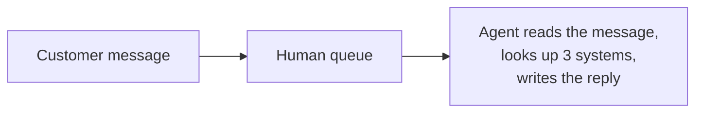
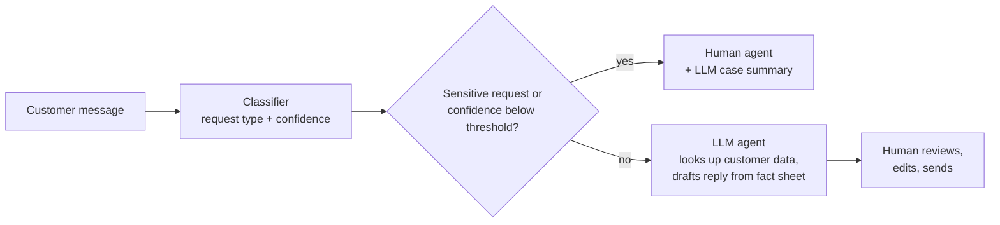
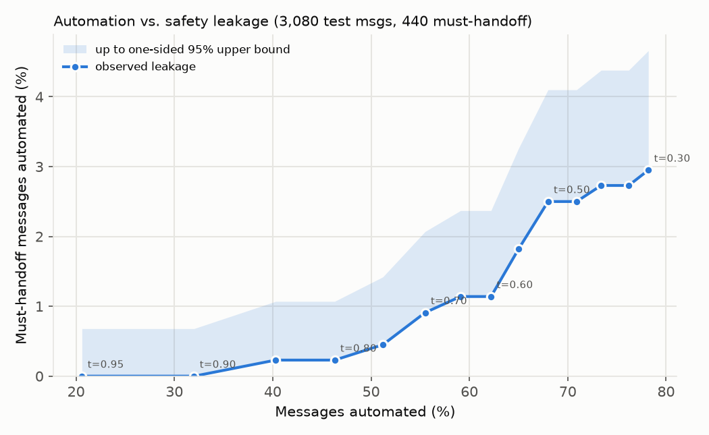

# Bank customer-service assistant: when should the AI hand over to a human?

**Albin Oruglica** · Mathematics & Operations Research, Aalto University

A working prototype of an AI assistant for a bank's customer service. It reads a customer's message, works
out what they want, looks up their data in (simulated) bank systems, and then answers, asks one clarifying
question, or hands the case to a human with a ready-made summary. The core question is an operations-research
one: **at what point should the AI hand over to a human, if the goal is the lowest total cost?**

**Recommendation:** use a cheap classifier to route each message, and a large language model (LLM) to draft
replies and case summaries for human agents. Don't let the LLM send replies on its own yet.

- **Routing works.** A free classifier sorts messages well enough that routing alone could save up to about
  €2.2–2.6 per message against fully manual handling, and the safety trade-off can be tuned: at the strictest
  setting, none of the 440 fraud, dispute and anti-money-laundering test cases were automated.
- **Replies don't, yet.** Measured end to end, 18% of the LLM's answers contained errors that automatic checks
  could not catch, so letting it answer unsupervised costs more than a human.
- **The OR insight.** The cost-optimal threshold for automating a message depends on how well the model's
  confidence matches its real accuracy. For the same data it ranged from 0.39 to 0.875 depending on one model
  setting, so it has to be set on held-out data, not read off a formula.

📄 **[One-page summary for business readers](docs/brief.pdf)**

| How messages are handled | Cost per message |
|---|---|
| Everything by a human (today) | **€5.00** |
| Classifier routes, *assuming* every routed message gets a correct reply (best case) | €2.83 |
| Classifier routes, LLM answers on its own (**measured**) | €5.1–6.0 |
| Classifier routes, LLM drafts, a human reviews and sends (**measured drafts**) | €4.66–5.25 |

The recommended design (a human reviews every AI draft) roughly breaks even with fully manual handling on these
numbers (€4.66–5.25 vs. €5.00), before counting the time human agents save from the AI's case summaries and
drafts, which this project did not measure.

The € figures are business assumptions, not measurements: €5 for a message handled by a person, €30 for a
wrong automated answer, and €300 for a sensitive case (fraud, dispute, money laundering) wrongly automated.
The code also shows how the results change when these values change (`src/threshold.py`, `src/hybrid.py`;
numbers in `results/*.json`). The $ figures further down are measured API prices.

## The problem

A bank receives a steady stream of short, often incomplete messages: *"my card still hasn't arrived"*, *"why
was I charged twice?"*, *"help my money isnt showing up"*. Answering them needs data from several systems.
People answer them reliably but expensively. An AI can answer instantly, but a confident wrong answer to a bank
customer causes real damage, and some cases (suspected fraud, money disputes, anti-money-laundering checks)
should never be decided by an AI at all.

> This mirrors the scenario in CGI Finland's *AI Trainee – Business & Solution Design* posting: *a customer's
> message may be incomplete and resolving it may need several systems; the AI should make sense of the
> situation, move it forward, recognise its own limits and bring in a human at the right moment.*

## Solution design

**Before:** every message waits in a human queue, and the agent starts from nothing.



**After (recommended on the current evidence):** the classifier triages; the LLM prepares the work.



Key design choices:

- **Two separate reasons to hand off.** *By rule, because of risk:* 11 of the 77 request types (fraud,
  disputes, account closure, source of funds, identity failures) always go to a human, whatever the AI thinks
  ([`src/policy.py`](src/policy.py)). *By threshold, because of uncertainty:* for everything else, the AI acts
  only when the classifier's confidence is above a cost-optimal threshold.
- **The LLM suggests, the code decides.** Business rules are enforced in ordinary, testable code, not by hoping
  the model obeys its instructions. In testing, the rule overrode the model 5 times.
- **Least privilege.** The LLM's tools take no customer ID; the code fills in the logged-in customer, so a
  message cannot make the model look at anyone else's data.
- **Data minimisation (GDPR).** The model only sees the profile fields it needs. Removing the profile's
  language field also fixed a bug where English messages got Finnish replies.
- **Grounding.** The LLM may only state fees, limits, times and app steps that appear in the bank's fact sheet
  ([`data/bank_facts.md`](data/bank_facts.md)) or the customer's data. This removed invented numbers, but not
  every invented fact (see below).
- **Fail safe.** If anything goes wrong (the model refuses, runs out of space or loops), the case goes to a
  human.

## Results

The models were tested on BANKING77, a public dataset of 13,083 banking customer questions labelled with 77 request
types (*intents*), with fictional customer data.

### 1. A classic classifier beats the LLM at recognising the request, on this benchmark

The classifier is a standard, cheap text model: it turns each message into word statistics (TF-IDF) and learns
from 10,003 labelled examples which statistics point to which request type (logistic regression). The LLM
(Claude Haiku 4.5) was given only the list of 77 request names, with no examples.

| | Correct request type (same 154 messages) | Cost per message |
|---|---|---|
| Classic classifier | **87.7%** (89.4% on all 3,080 test messages) | ≈ $0 |
| LLM, no examples | 70.1% | $0.0084 |

This comparison favours the classifier, and some of the LLM's "errors" are really the dataset's labelling
conventions. The claim is narrow: without examples, the LLM loses to a trained classifier on this dataset.

### 2. The optimal threshold is a property of the model, not a formula

Decision theory says: automate a message when the chance of being right is above 1 − (cost of a human ÷ cost of
a wrong answer) = 1 − 5/30 ≈ 0.83. That only works if the model is **calibrated**, meaning that when it says
"80% sure" it is right 80% of the time. Our classifier is *under*confident: messages it scores around 0.55 are
already right more than 80% of the time. So the cost-optimal threshold on held-out data is **0.62**, not 0.83.
Changing one regularisation setting makes the same classifier well calibrated and moves its optimal threshold to
0.875. The threshold therefore has to be chosen on held-out data for the model actually deployed.


### 3. Safety is a curve, not a number

How many of the 440 test messages that must go to a human would be automated, for each threshold:



At 0.62, 5 of 440 (1.1%) slip through, which is not acceptable if replies are sent automatically. At 0.9 none
were observed (at most 0.7% with 95% confidence), but only 32% of messages are automated.

### 4. Measured end to end, reply quality decides

The LLM was given the classifier's request type (correct 98% of the time) and wrote the replies. A second,
stronger model (Claude Sonnet 5) then checked each reply against the customer's data and the fact sheet, and the
verdicts were spot-checked.

- **29 of 154 messages (19%)** were fully and correctly handled by the AI.
- **7 of the 38 answers the AI sent (18%)** had real errors, such as top-up limits applied to disposable
  cards or an invented card-renewal policy. None of them was caught by the automatic number and menu-path
  checks.
- The LLM asked a clarifying question in 37 of 91 cases. Counting that each question still needs a follow-up
  (by a person or by the AI), the system costs **€5.1–6.0 per message**, against €5.00 for handling everything
  by hand.

An end-to-end test like this is what weakened my first, optimistic estimate (€2.39 per message, which assumed
correct replies).

## Limitations and risks

- **Wrong answers to customers.** 18% of the LLM's checked answers had real errors, mostly a correct fact
  applied to the wrong case or a plausible-sounding invented policy, which simple checks cannot see. This is the
  main reason not to let it answer on its own.
- **Where AI should not decide.** Fraud, disputes, account closure and anti-money-laundering checks go to
  humans by explicit, auditable rules, and the leakage past those rules is *measured*, not assumed to be zero.
- **Privacy (GDPR).** Sending customer data to an external AI service needs a legal basis and a
  data-processing agreement. Data minimisation and least privilege reduce, but do not remove, this concern; a
  locally hosted model would keep data in-house at a cost in quality.
- **Simulation.** Customer data is fake and assigned to messages at random (so it often contradicts the
  message), and the fact sheet is 11 lines. Both push the measured cost up.
- **Benchmark mix.** The test set has exactly 40 messages per request type; a real inbox is dominated by a few
  types, so the savings figures do not transfer directly.
- **Small samples and assumptions.** 154 messages for the LLM and 38 checked answers; all costs are
  assumptions. The checking model makes mistakes in both directions, so its verdicts were spot-checked.

## How to run it

Tested with Python 3.11 and 3.14 (Windows, PowerShell):

```powershell
py -m venv .venv
.\.venv\Scripts\Activate.ps1
pip install -r requirements.txt
```

(macOS/Linux: `python3 -m venv .venv`, `source .venv/bin/activate`.)

**Reproduce every number in this README, with one command. No API key, no cost:**

```
python src/reproduce.py
```

It downloads BANKING77, trains the classifier, runs cross-validation, and recomputes all metrics and charts
from the committed LLM results (about 3–8 minutes). Key outputs: `results/threshold_metrics.json`,
`results/hybrid_metrics.json`, `results/evaluation_metrics.json`.

**Optional: re-run the LLM parts (costs money).** Copy `.env.example` to `.env` and add an Anthropic API key,
then `python src/check_setup.py`. `python src/run_agent.py test 2` (about $1.30) and `python src/hybrid.py`
(about $1.00) show a cost estimate and ask for confirmation before spending. Results are cached, so re-runs
are free.

## Repository layout

| Path | Contents |
|---|---|
| `src/policy.py` | the 11 request types that always go to a human |
| `src/baseline.py` | the classic classifier (TF-IDF + logistic regression) |
| `src/systems.py` | simulated bank systems (customer, cards, transactions) used as LLM tools |
| `src/agent.py` | the LLM agent: instructions, tool use, structured output, business rules, cache |
| `src/threshold.py` | cost model, optimal threshold, safety curve, sensitivity analysis |
| `src/hybrid.py`, `src/judge.py` | the recommended design run end to end, and the checking model |
| `src/evaluate.py`, `src/grounding.py`, `src/calibration_check.py` | evaluation and checks |
| `src/reproduce.py` | runs all free steps in order |
| `data/` | fake customers, cards, transactions and the bank's fact sheet (no real personal data) |
| `results/` | committed predictions, LLM outputs, checking verdicts, metrics and charts |
| `docs/` | the one-page summary for business readers (LaTeX source and PDF) |

## How it was built

I directed the project with [Claude Code](https://claude.com/claude-code). I set the goal and constraints,
chose between the options it proposed (which request types always go to a human, the cost assumptions, the $5
API budget, whether to pay for the end-to-end test), and checked the results. Claude Code wrote and ran the
code. Checking the results turned up several mistakes, from a language bug to a headline number that measured
the wrong thing, and each was fixed and documented. Total API spend: $2.66.

## Data and credits

- **BANKING77** by PolyAI (Casanueva et al., 2020, *Efficient Intent Detection with Dual Sentence Encoders*),
  licensed [CC BY 4.0](https://creativecommons.org/licenses/by/4.0/). 13,083 banking customer queries
  labelled with 77 intents. Downloaded automatically from
  [PolyAI-LDN/task-specific-datasets](https://github.com/PolyAI-LDN/task-specific-datasets) by
  `src/load_data.py`; not redistributed in this repo.
- All customer data in `data/` is invented. "ExampleBank" is fictional.
